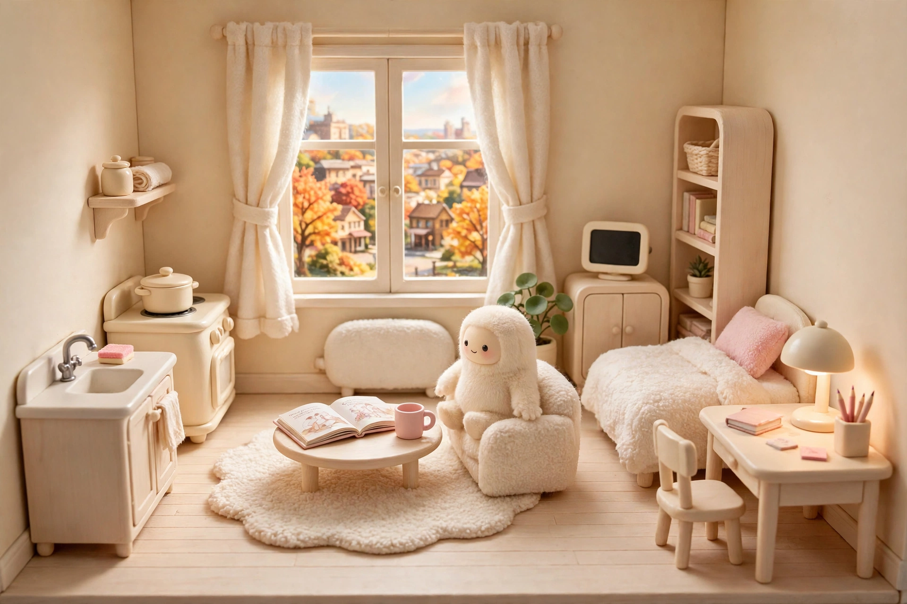

# Museの箱庭（muse-hakoniwa）

AIキャラクターが暮らすミニチュアのお部屋「箱庭」を、あなたのアバターから作るプロンプト集です（Muse 用）。

A prompt kit for Muse that builds a miniature *hakoniwa* room where your AI character lives — the room's design and every furnishing are designed from your avatar.

*作例：デフォルトアバター（Jolly）のためにアバターから設計したお部屋。昼のシーン*

## これは何か

部屋の絵を1枚作って終わり、ではありません。あなたの Muse のキャラクターが小さな部屋で暮らし続け、1時間ごとに「いま何をしているか」の絵と日記が届く仕組みを、あなたの Muse に作ってもらうためのプロンプトです。

- 部屋の間取り（3ゾーン）と画角は固定の骨組みで再現性を保ちます
- 部屋のデザインと調度品はすべて、**あなたの決めたアバター**から設計します（配色・モチーフ・衣装の様式・キャラクターの形態が起点）。配布元のキャラクターの部屋は持ち込みません
- 着替えられないキャラクターには着替えさせません。就寝時の姿などは、そのキャラクターに合う代替表現に置き換えます

## 中身

- [`prompt.md`](prompt.md) — 配布用プロンプト本体。これを自分の Muse に渡して使います
- [`examples/jolly/`](examples/jolly/profile-and-design-sheet.md) — 作例：Muse のデフォルトアバター（Jolly）のプロファイルとデザインシート、試作の検品結果。簡易キャラクターシートのサンプル画像（`character-sheet.webp`）も収録

## 使い方

いちばん簡単なのは、このリポジトリのアドレスを自分の Muse に渡すことです。次の文をそのまま送ってください。

> https://github.com/loosephoto/muse-hakoniwa の prompt.md を読んで、手順どおりに私のキャラクターのお部屋を実装してください。まずプロファイルとデザインシートの相談から始めてください。

手作業で進める場合は：

1. `prompt.md` の「プロンプト本文」を、そのまま自分の Muse に渡します
2. 最初に、自分のキャラクターのプロファイルと、アバターから設計するデザインシートを埋めます（作例が入っています）。作画を安定させるため、キャラクターシート（全身・表情数種・カラーパレット）を1枚作って参照に使うことを強く勧めています
3. 部屋の試作を見て承認してから、本実装に進みます

## 仕組みの概要（本体に含まれるもの）

- 1時間ごとの自動更新（スペース表示＋時刻・天気＋直近10件のログ）
- 時間帯（朝／昼／夕方／就寝前／就寝）と平日・休日の過ごし方、季節で変わる窓の外の景色
- 行動の多様化（消去法：使い切り＋直近5件の除外＋場所のローテーション）
- 食事の時間（昼 11:00–13:00／夕 18:00–20:00、メニューはその日の話題と気分で決める）
- 外出と家でのイベント（お買い物／お出かけ／庭仕事／掃除・洗濯／地域のふれあい。外出できない日は室内スナップに切り替え）
- 週に一度の来客（水〜日のいずれか1日の15:00。固定するのは役割4種＝年長者／作り手・お店の人／お友達／動物だけで、担当者は回ごとに変わります。担当者候補は自分のアバターから設計し、プロファイルの `visitor_roster` に記録します）
- ノートパソコンで今話題の内容を見る（1日0〜1回、優しく明るい話題だけ）
- 災害時の演出（日本国内向け：気象庁の情報で震度3以上の地震・暴風警報を判定。日本国外では現地の警報への置き換え、または無効化）

## 任意の拡張（別途配布）

調理の様子を5〜10秒の動画にして別スペースに貼る「お料理動画」は、**別途配布の任意拡張**です。本体のプロンプトには含まれず、本体は拡張が無くても単体で完結します（調理の回は調理画像の保存確認で完了し、動画が無いことは失敗ではありません）。

## 作例について

`examples/jolly/` は、デフォルトアバター Jolly（クリーム色のふわふわしたマスコット）で実際に試した記録です。配布元のキャラクター（メイド）の部屋とは全く違う、クリームと淡い木とピンクの柔らかい部屋が生成されました。作画安定のために作った簡易キャラクターシートのサンプル（`character-sheet.webp`）と、昼のシーンの試作画像（`day-scene.webp`）を収録しています。

## 由来

このプロンプトは、実際に運用している「きなこのお部屋」（メイドのキャラクターが雪国の家で暮らし、1時間ごとに様子が届くスペース）から、キャラクター固有の部分を取り除いて一般化したものです。

## ライセンス

MIT License のもとで公開しています。全文は [`LICENSE`](LICENSE) をご覧ください。

This project is released under the MIT License. See [`LICENSE`](LICENSE) for details.
